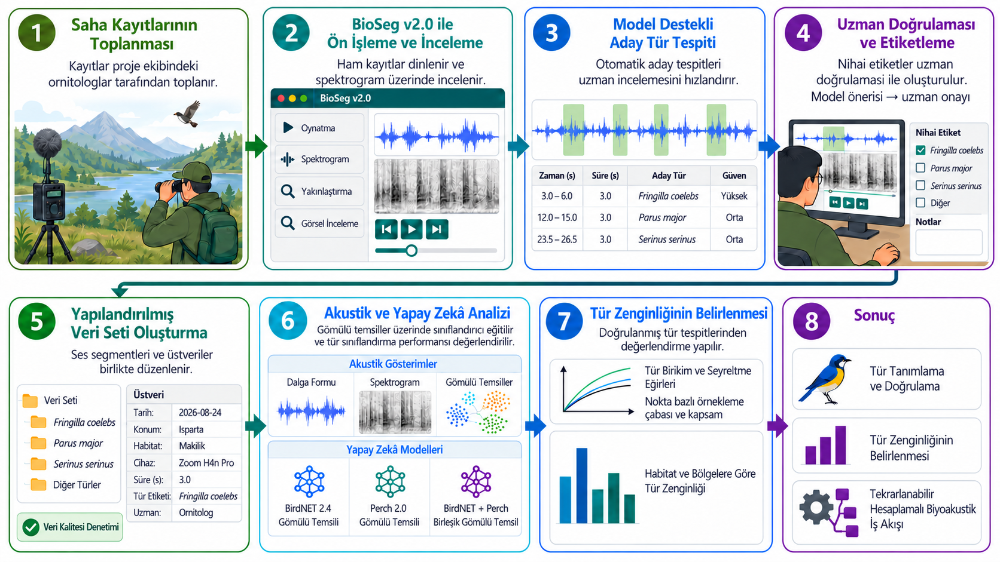
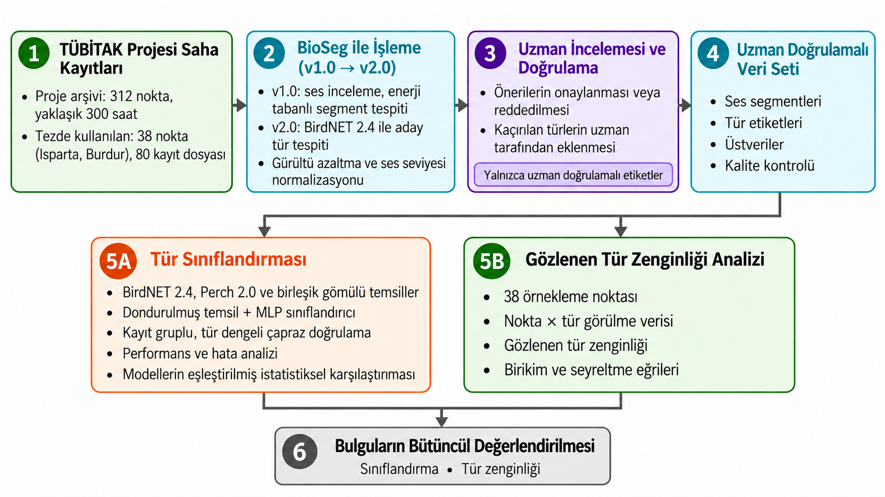
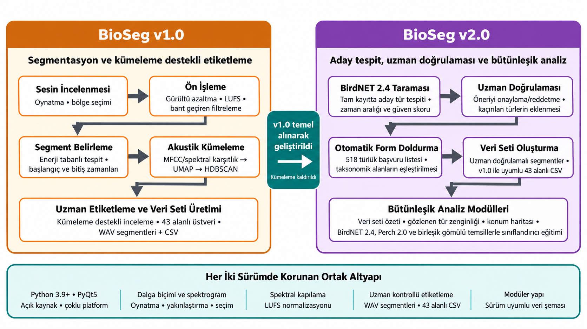
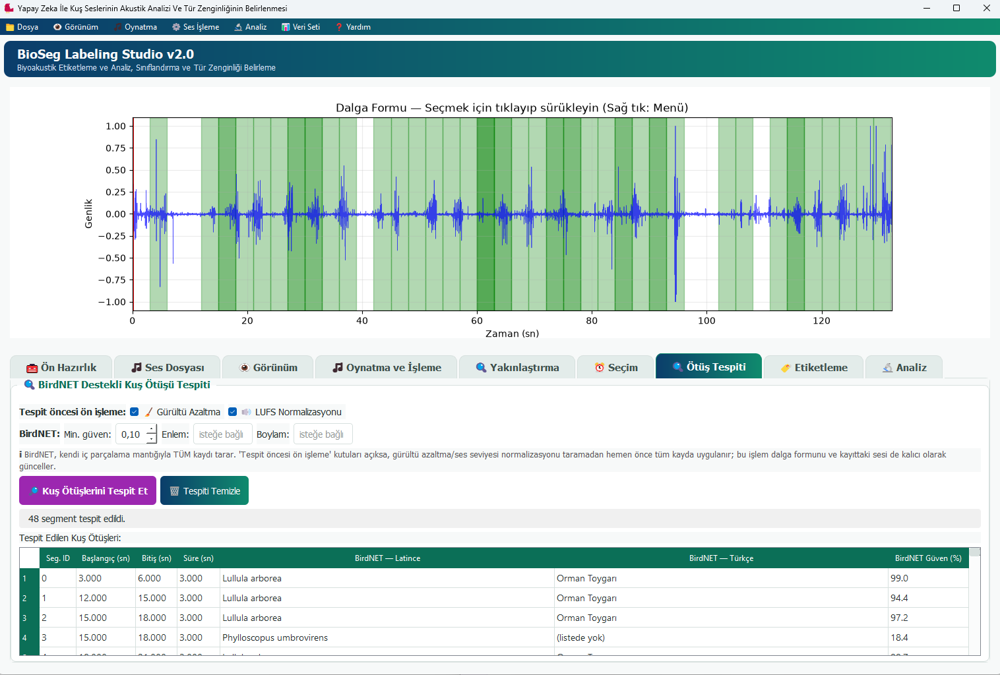
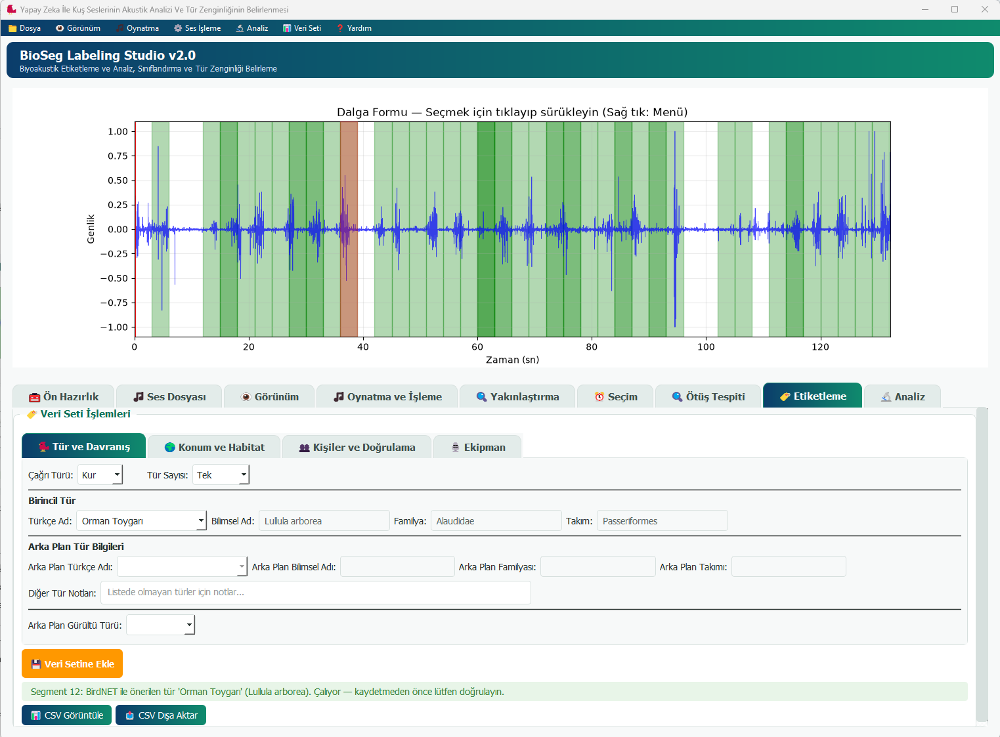
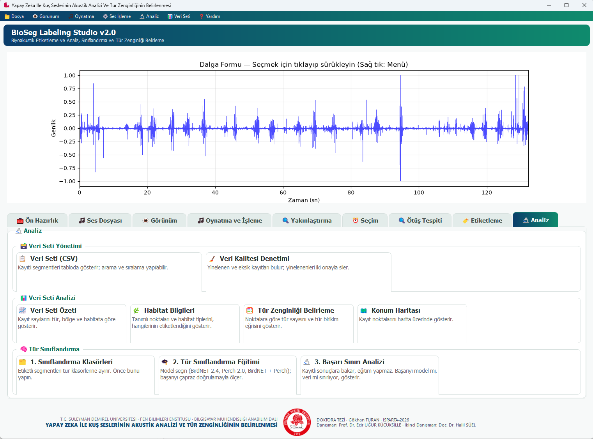

# 🐦 Yapay Zekâ ile Kuş Seslerinin Akustik Analizi ve Tür Zenginliğinin Belirlenmesi

**BioSeg Labeling Studio v2.0** · Doktora tezi yazılımı · Süleyman Demirel Üniversitesi, Fen Bilimleri Enstitüsü, Bilgisayar Mühendisliği Anabilim Dalı

[](https://www.gnu.org/licenses/agpl-3.0)
[](https://www.python.org/downloads/)
[](https://doi.org/10.5281/zenodo.24110426)

[English README](README.en.md)

BioSeg, kuş ses kayıtlarını segmentlere ayırmak, uzman doğrulamasıyla etiketlemek ve yapılandırılmış bir veri seti oluşturmak için geliştirilmiş açık kaynaklı bir araştırma yazılımıdır. Yazılım; dalga biçimi ve spektrogram görüntüleme, ses ön işleme (gürültü azaltma, ses düzeyi normalleştirme), **BirdNET-Analyzer** ile aday tür tespiti, zengin üstveri etiketleme, gözlenen tür zenginliği analizi (tür birikim ve seyreltme eğrileri) ve dondurulmuş **BirdNET 2.4** ile **Perch 2.0** gömülü temsilleri (tek tek ve birleşik) üzerinde tür sınıflandırıcı eğitimi ve karşılaştırması özelliklerini bir arada sunar. Çıktı, eşleşen ses segmentleriyle birlikte kullanıma hazır bir CSV veri setidir.

> **Yazılımın kapsamı:** Yazılım toplam tür zenginliğini **tahmin etmez**. Tür zenginliği analizleri yalnızca gözlenen (belirlenen) türlere, tür birikim eğrilerine ve seyreltmeye dayanır; ekstrapolasyon veya asimptotik zenginlik kestiricisi içermez.

---

## ✨ Özellikler

- **Ses görüntüleme:** Etkileşimli dalga biçimi ve spektrogram (doğrusal/Mel), yakınlaştırma, kaydırma ve bölge seçimi
- **Ön işleme:** Spektral kapılama ile gürültü azaltma, LUFS ses düzeyi normalleştirme; ayrı bir adım olarak ya da tespitten hemen önce otomatik uygulanabilir
- **Aday tür tespiti:** [BirdNET-Analyzer](https://birdnet.cornell.edu/) (Cornell K. Lisa Yang Biyoakustik Koruma Merkezi) kaydın tamamını tarar
- **Otomatik doldurulan etiketleme:** Tespit edilen segmente tıklamak, formu (Türkçe ad, bilimsel ad, familya, takım) 518 türlük başvuru tablosundan doldurur. Kaydetmeden önce her zaman dinleyerek doğrulayın
- **Zengin üstveri:** Taksonomi, konum ve habitat, kayıt ekipmanı ve doğrulama durumunu kapsayan 43 alan
- **Veri seti dışa aktarımı:** Her etiketli segment bir WAV dosyası ve CSV'de bir satır olarak kaydedilir
- **Tür zenginliği belirleme:** Nokta, habitat ve bölge düzeyinde gözlenen tür sayıları, örnekleme çabası, tür birikim ve seyreltme eğrileri
- **Tür sınıflandırma:** BirdNET 2.4, Perch 2.0 ve ikisinin birleşimi üzerinde, kayıt gruplu çapraz doğrulama ile eğitim, karşılaştırma ve anlamlılık testi
- **Yapay zekâ ile tür zenginliği:** Sınıflandırma çıktılarından nokta düzeyinde tür listeleri oluşturur ve uzman listeleriyle karşılaştırır
- **Veri kalitesi araçları:** Yinelenen ve eksik kayıt denetimi, tanım verileri yöneticisi, CSV görüntüleyici, konum haritası
- **Platform:** Windows, Linux ve macOS (paketlenmiş `.exe` yalnızca Windows)

> **Modellerin rolleri:** Aday tür tespiti ("Ötüş Tespiti") yalnızca **BirdNET** ile yapılır. "Tür Sınıflandırma Eğitimi" aracında **BirdNET 2.4** ve **Perch 2.0** dondurulmuş özellik çıkarıcı olarak kullanılır (ince ayar yapılmaz): BirdNET 2.4 her 3 saniyelik etiketli segmenti 1024 boyutlu, Perch 2.0 ise 1536 boyutlu bir gömülü temsile dönüştürür; üçüncü seçenek ikisini art arda ekler (2560 boyut, erken birleştirme). Her temsil üzerinde aynı tarifle (katman genişlikleri girdi boyutuna göre ölçeklenir) bir MLP sınıflandırıcı eğitilir ve üçü kayıt gruplu çapraz doğrulamayla karşılaştırılır. Perch 2.0, 5 saniyelik pencere bekler; 3 saniyelik segmentler 5 saniyeye sıfırla tamamlanır. Bu, modelin belirtimi dışındadır ve Perch sonuçları bu bilgiyle yorumlanmalıdır.

## 🧬 BioSeg v1.0'dan v2.0'a

BioSeg v2.0, **BioSeg v1.0**'ın ses işleme, görselleştirme, segmentasyon ve uzman kontrollü etiketleme altyapısı temel alınarak geliştirilmiştir; 43 alanlı CSV şeması iki sürümde uyumludur. v1.0 enerji tabanlı segment tespiti ve MFCC/spektral karşıtlık → UMAP → HDBSCAN ile akustik kümeleme kullanıyordu. v2.0'da kümeleme kaldırılmış, yerine BirdNET 2.4 ile aday tür tespiti, otomatik form doldurma ve sınıflandırma ile tür zenginliği analiz modülleri eklenmiştir.

BioSeg v1.0, aşağıdaki makaleyle tanıtılmıştır; v1.0 için bu makaleye atıf yapınız:

> Turan, G., Küçüksille, E.U., Süel, H. (2026). BioSeg: An open-source software for bioacoustic segmentation, cluster-assisted labeling, and dataset generation. *SoftwareX*, 35, 102902. https://doi.org/10.1016/j.softx.2026.102902

---

## 🔧 Kurulum

### Kaynak koddan kurulum

1. Depoyu klonlayın:
   ```bash
   git clone https://github.com/gokhanturan/BioSegv2.git
   cd BioSegv2
   ```
2. Sanal ortam oluşturun (önerilir):
   ```bash
   python -m venv .venv
   # Windows
   .venv\Scripts\activate
   # Linux / macOS
   source .venv/bin/activate
   ```
3. Bağımlılıkları kurun:
   ```bash
   pip install -r requirements.txt
   ```
4. **BirdNET, `ffmpeg` gerektirir.** Ayrıca kurulur (pip ile kurulmaz):
   ```bash
   # Windows
   winget install ffmpeg
   # Ubuntu/Debian
   sudo apt-get install ffmpeg
   # macOS
   brew install ffmpeg
   ```
5. **BirdNET gömülü temsilleri** `birdnet` paketiyle çıkarılır; BirdNET 2.4 modeli ilk kullanımda otomatik indirilir.
6. **Perch 2.0 modeli** `kagglehub` ile Kaggle'dan indirilir (işlemci sürümü: `google/bird-vocalization-classifier`, TensorFlow 2, `perch_v2_cpu`, sürüm 1; GPU sürümü: `perch_v2`). İsterseniz modeli elle indirip uygulama klasöründeki `perch_model/` klasörüne koyabilir ya da `PERCH_MODEL_DIR` / `PERCH_MODEL_HANDLE` ortam değişkenlerini kullanabilirsiniz. Perch 2.0, TensorFlow ≥ 2.20 gerektirir.
7. Yazılımı çalıştırın:
   ```bash
   python src/main.py
   ```

### Geliştirme ortamı olmadan çalıştırma (paketlenmiş `.exe`)

PyCharm veya başka geliştirme araçları kurmadan çalıştırmak için `TEAM_SETUP_GUIDE.md` dosyasına bakın (yalnızca Python 3.12 gerektiren `setup_bioseg.bat` + `run_bioseg.bat` çifti). PyInstaller ile tek tıkla açılan bağımsız bir `BioSeg.exe` üretmek için `build_exe.bat` kullanılır.

## 🛠️ Sorun Giderme

### Linux (Ubuntu/Debian)
`pip install -r requirements.txt` soundfile ile ilgili hata verirse:
```bash
sudo apt-get install libsndfile1
pip install --upgrade pip
pip install -r requirements.txt
```

### Windows
Derleme hatası alırsanız Microsoft C++ Build Tools'u kurun: https://visualstudio.microsoft.com/visual-cpp-build-tools/

TensorFlow `DLL load failed` / `DllMain returned false` (hata kodu `0x45A`) hatasıyla yüklenmezse, sistemde çakışan veya eski bir `msvcp140.dll` vardır (PATH'teki bir Anaconda kurulumu ya da PyQt5'in kendi `Qt5\bin\MSVCP140.dll` kopyası olabilir). Suçluyu bulmak için **Olay Görüntüleyicisi → Windows Günlükleri → Uygulama** altında, çalıştırma anındaki "Uygulama Hatası" kaydında **"Hatalı modül yolu"** alanına bakın.

Aşağıdaki sıra denememizde hatayı sürekli çözmüştür:
```bash
# 1. Microsoft Visual C++ Redistributable'ı kurun/güncelleyin:
#    https://learn.microsoft.com/en-us/cpp/windows/latest-supported-vc-redist

# 2. TensorFlow'u tamamen kaldırıp yeniden kurun:
pip uninstall -y tensorflow tensorflow-intel tensorflow-hub
pip cache purge

# 3. Perch 2.0'ın asgari gereksinimini sağlayan sürümü açıkça belirterek kurun.
#    Sürüm belirtmeden kurmak eski bir sürümde (ör. 2.19.x) kalmanıza yol açabilir; bu sürüm
#    Perch 2.0'ın model biçimini yükleyemez ("Cannot deserialize computation / vhlo.cosine_v2").
pip install --no-cache-dir --upgrade "tensorflow>=2.20.0rc0" "tensorflow-hub>=0.16.1"

# 4. Doğrulayın:
python -c "import tensorflow as tf; print(tf.__version__)"   # >= 2.20 yazmalı
```
4. adım hâlâ başarısızsa, sanal ortamı Anaconda yerine **python.org** Python'uyla oluşturmayı deneyin. Sanal ortamın temeli Anaconda olmasa bile, PATH'te başka bir yerde Anaconda kurulumu varsa Windows DLL'i oradan çözebilir.

### `ModuleNotFoundError: pkg_resources`
`setuptools >= 82.0.0`, `tensorflow_hub`'ın hâlâ bağımlı olduğu `pkg_resources` modülünü kaldırmıştır. `requirements.txt` zaten `setuptools<82` sabitler; hata sürerse:
```bash
pip install "setuptools<82"
```

### `Generic audio read error occurred from librosa` (BirdNET çalışırken)
`birdnetlib`'in bu hata iletisi yanıltıcı biçimde geneldir; çoğu zaman bozuk bir ses dosyası değil, librosa'nın yeniden örnekleme için gereksindiği `resampy` paketinin eksikliğidir:
```bash
pip install resampy
```

### Genel
`pip` tanınmıyorsa:
```bash
python -m pip install -r requirements.txt
```

---

## 🎯 Hızlı Başlangıç

Arayüz Türkçedir. Ana sekmeler: **Ön Hazırlık, Ses Dosyası, Görünüm, Oynatma ve İşleme, Yakınlaştırma, Seçim, Ötüş Tespiti, Etiketleme, Analiz**.

### 1. Ses dosyasını yükleyin
**"Ses Dosyası Yükle (.wav)"** düğmesiyle bir WAV dosyası seçin. Dalga biçimi görüntülenir; süre, örnekleme hızı, kanal sayısı ve bit derinliği bilgi panelinde görünür.

### 2. Görüntüyü inceleyin
- **Yakınlaştırma:** Fare tekerleği
- **Kaydırma:** Sağ tık + sürükleme
- **Bölge seçimi:** Sol tık + sürükleme

### 3. Ön işleme (isteğe bağlı)
- **Gürültü azaltma** (spektral kapılama) ve **LUFS normalleştirme** (hedef −16 LUFS) seçenekleriyle **"İşlemleri Çalıştır"** düğmesini kullanın; seçili bölgeye ya da kaydın tamamına uygulanır.

### 4. Kuş ötüşlerini tespit edin
**"Ötüş Tespiti"** sekmesinde:
- Gürültü azaltma ve LUFS normalleştirme kutuları varsayılan olarak açıktır; kayıt, taramadan hemen önce otomatik olarak temizlenir ve normalleştirilir.
- BirdNET'in en düşük güven eşiğini ayarlayın (varsayılan 0,10; tezde 0,50 kullanılmış, coğrafi süzgeç uygulanmamıştır); isterseniz eBird tabanlı menzil süzgeci için enlem ve boylam girin.
- **"Kuş Ötüşlerini Tespit Et"** düğmesine basın.

BirdNET kaydın tamamını kendi iç parçalamasıyla tarar. Sonuçlar tabloda (bilimsel ad, Türkçe ad, güven) görünür; tespit edilen bölgeler dalga biçiminde vurgulanır.

### 5. İnceleyin ve etiketleyin
Tablodaki bir satıra tıklamak o segmenti seçer, vurgular ve oynatır. Etiketleme formu BirdNET tahminiyle (Türkçe ad, bilimsel ad, familya, takım) önceden doldurulur. **Kaydetmeden önce dinleyerek doğrulayın.** Kalan üstveriyi doldurun:
- **Tür ve Davranış:** Çağrı türü, tür sayısı, birincil tür (Türkçe ad, bilimsel ad, familya, takım), arka plan türü bilgileri, diğer tür notları, arka plan gürültü türü
- **Konum ve Habitat:** Alan, habitat tipi, koordinatlar
- **Kişiler ve Doğrulama:** Kaydeden kişi, ornitolog, güven düzeyi
- **Ekipman:** Mikrofon, kaydedici, kaynağa uzaklık

### 6. Veri setine ekleyin
**"Veri Setine Ekle"** düğmesine basın. Segment `segments/` klasörüne WAV olarak kaydedilir ve `bird_sound_dataset.csv` dosyasına 43 üstveri alanıyla bir satır eklenir.

### 7. Veri setini analiz edin
**"Analiz"** sekmesi veri seti düzeyindeki araçları toplar:

| Grup | Araç | Ne yapar |
|---|---|---|
| Veri Seti Yönetimi | Veri Seti (CSV) | Kayıtlı segmentleri tabloda gösterir; arama ve sıralama yapılabilir |
| | Veri Kalitesi Denetimi | Yinelenen ve eksik kayıtları bulur; yinelenenleri iki onayla siler |
| Veri Seti Analizi | Veri Seti Özeti | Kayıt sayılarını tür, bölge ve habitata göre gösterir |
| | Habitat Bilgileri | Tanımlı noktaları ve habitat tiplerini, hangilerinin etiketlendiğini gösterir |
| | Tür Zenginliği Belirleme | Noktalara göre tür sayısını, tür birikim ve seyreltme eğrilerini ve yapay zekâ karşılaştırmasını gösterir |
| | Konum Haritası | Kayıt noktalarını harita üzerinde gösterir |
| Tür Sınıflandırma | 1. Sınıflandırma Klasörleri | Etiketli segmentleri tür klasörlerine ayırır; önce bu yapılmalıdır |
| | 2. Tür Sınıflandırma Eğitimi | Model seçilir (BirdNET 2.4, Perch 2.0, BirdNET + Perch); başarı çapraz doğrulamayla ölçülür. Seçim penceresindeki **Model Karşılaştırma** düğmesi kayıtlı sonuçları yan yana gösterir |
| | 3. Başarı Sınırı Analizi | Kayıtlı sonuçlara bakar, eğitim yapmaz; başarıyı modelin mi verinin mi sınırladığını gösterir |

Tür listesini, habitat noktalarını ve açılır listeleri düzenleyen **Tanım Verileri Yöneticisi** ve **Yedekten Geri Yükle** araçlarına **Ön Hazırlık** sekmesinden ve **Veri Seti** menüsünden ulaşılır.

## 🖼️ Ekran Görüntüleri

### Yazılımın iş akışı


*Şekil 1. Saha kaydından tür zenginliğinin belirlenmesine uzanan sekiz adımlı iş akışı.*

### Araştırma tasarımı


*Şekil 3.1. Saha kayıtlarından uzman doğrulamalı veri setine, oradan sınıflandırma ve gözlenen tür zenginliği analizlerine uzanan araştırma tasarımı.*

### BioSeg v1.0 ve v2.0


*Şekil 3.2. BioSeg v1.0 (segmentasyon ve kümeleme destekli etiketleme) ile BioSeg v2.0 (aday tespit, uzman doğrulaması ve bütünleşik analiz) ve iki sürümde korunan ortak altyapı.*

### Ötüş tespiti


*Şekil 3.6. "Ötüş Tespiti" sekmesi: BirdNET çalıştırıldıktan sonra tespit edilen bölgeler dalga biçiminde vurgulanır; tablo bilimsel ad, Türkçe ad ve BirdNET güven değerini gösterir.*

### Etiketleme


*Şekil 3.7. "Etiketleme" sekmesi (Tür ve Davranış): BirdNET önerisiyle önceden doldurulan form; kaydetmeden önce dinleyerek doğrulama uyarısı.*

### Analiz paneli


*Şekil 3.8. "Analiz" sekmesi: Veri Seti Yönetimi, Veri Seti Analizi ve Tür Sınıflandırma araçları kart biçiminde toplanır.*

## 📊 Çıktı Biçimi

Her etiketli segment için:
- `segments/` klasörüne bir WAV dosyası: `{özgün_ad}_Habitat{ID}_{Tür}_{Tarih}.wav`
- `bird_sound_dataset.csv` dosyasına, aşağıdaki 43 üstveri alanını içeren bir satır (şema, veri seti uyumluluğu için BioSeg v1.0 ile aynıdır):

| #  | Kategori       | Alan Adı                    | Açıklama                                         |
|----|----------------|-----------------------------|--------------------------------------------------|
| 1  | Kayıt          | Original_Recording_Name     | Özgün kayıt tanımlayıcısı                        |
| 2  | Kayıt          | Original_File_Path          | Kaynak dosya yolu                                |
| 3  | Kayıt          | Original_Duration           | Toplam süre (sn)                                 |
| 4  | Kayıt          | Channels                    | Kanal sayısı                                     |
| 5  | Kayıt          | File_Format                 | Ses biçimi (ör. WAV)                             |
| 6  | Kayıt          | Bit_Depth                   | Bit çözünürlüğü                                  |
| 7  | Kayıt          | Recording_Date              | Kayıt tarihi                                     |
| 8  | Kayıt          | Recording_Time              | Kayıt saati                                      |
| 9  | Segment        | Filename                    | Segment dosya adı                                |
| 10 | Segment        | File_Path                   | Segment dosya yolu                               |
| 11 | Segment        | Start_Time                  | Segment başlangıcı (sn)                          |
| 12 | Segment        | End_Time                    | Segment bitişi (sn)                              |
| 13 | Segment        | Duration                    | Segment süresi (sn)                              |
| 14 | Ses bilgisi    | Call_Type                   | Vokalizasyon türü (Kur / Çağrı)                  |
| 15 | Ses bilgisi    | type_Count                  | Ötüş sayısı                                      |
| 16 | Taksonomi      | Order                       | Takım                                            |
| 17 | Taksonomi      | Family                      | Familya                                          |
| 18 | Taksonomi      | Scientific_Name             | Bilimsel ad                                      |
| 19 | Taksonomi      | Turkish_Name                | Türkçe ad                                        |
| 20 | Arka plan      | Background_Order            | Arka plandaki türün takımı                       |
| 21 | Arka plan      | Background_Family           | Arka plandaki türün familyası                    |
| 22 | Arka plan      | Background_Scientific_Name  | Arka plandaki türün bilimsel adı                 |
| 23 | Arka plan      | Background_Turkish_Name     | Arka plandaki türün Türkçe adı                   |
| 24 | Arka plan      | Background_Noise_Type       | Çevresel gürültü türü                            |
| 25 | Arka plan      | Notes_For_Other_Species     | Diğer türler için notlar                         |
| 26 | Konum          | Location                    | Alan tanımlayıcısı                               |
| 27 | Kişiler        | Recordist                   | Kaydeden kişi                                    |
| 28 | Kişiler        | Ornithologist               | Uzman etiketleyici                               |
| 29 | Doğrulama      | Verification_Status         | Doğrulama durumu                                 |
| 30 | Doğrulama      | Confidence_Level            | Etiket güven düzeyi                              |
| 31 | Ekipman        | Microphone                  | Mikrofon modeli                                  |
| 32 | Ekipman        | Recorder                    | Kayıt cihazı                                     |
| 33 | Habitat        | Habitat_ID                  | Habitat (nokta) tanımlayıcısı                    |
| 34 | Habitat        | Habitat_Type                | Habitat sınıfı                                   |
| 35 | Habitat        | Code                        | Habitat/alan kodu                                |
| 36 | Konum          | UTM_Zone                    | UTM bölgesi                                      |
| 37 | Konum          | UTM_Easting                 | UTM doğu                                         |
| 38 | Konum          | UTM_Northing                | UTM kuzey                                        |
| 39 | Konum          | Lat                         | Enlem                                            |
| 40 | Konum          | Lon                         | Boylam                                           |
| 41 | Konum          | Google_Maps                 | Harita bağlantısı                                |
| 42 | Notlar         | Notes                       | Serbest metin notları                            |
| 43 | Proje          | Project                     | Proje tanımlayıcısı                              |

## 📈 Tür Zenginliği Belirleme

**Analiz → Tür Zenginliği Belirleme** penceresi, her noktada ve bölgede belirlenen türleri ve bunların arkasındaki örnekleme çabasını raporlar. Pencerenin sekmeleri: *Genel Bakış, Noktalar, Habitat / Bölge, Tür Yapısı, Yapay Zekâ, Yöntem / Rapor*.

- **Örnekleme birimi:** `Habitat_ID` ile tanımlanan örnekleme noktasıdır. Bir tür, bir noktada uzman doğrulamalı en az bir segmentte belirlenmişse o noktada var kabul edilir (nokta × tür varlık-yokluk, yani insidans matrisi). Aynı noktadaki birden çok kayıt ve segment tek birim içinde birleştirilir.
- **Gözlenen tür zenginliği:** Nokta, habitat sınıfı ve il düzeyinde, en az bir noktada belirlenen farklı tür sayısıdır.
- **Seyreltme (rarefaction):** Farklı sayıda noktaya sahip grupların karşılaştırılabilmesi için örnek temelli analitik formülle hesaplanır (Coleman vd., 1982; Colwell vd., 2004): S(k) = Σ_i [1 − C(m − n_i, k) / C(m, k)]. Burada m nokta sayısı, k seçilen nokta sayısı, n_i i. türün belirlendiği nokta sayısıdır. Gruplar, en az noktaya sahip grubun nokta sayısına seyreltilerek karşılaştırılır.
- **Tür birikim eğrisi:** Aynı formülle k = 1, 2, …, m için çizilir; noktalar rastgele sırayla eklendikçe beklenen tür sayısını gösterir. ±1 standart sapma bandı yalnızca eldeki noktaların farklı sıralanmasından kaynaklanan değişkenliği yansıtır. Eğri son noktada sona erer; ekstrapolasyon ve asimptotik zenginlik kestirimi yapılmaz. Yatay seyreden bir eğri örnekleme yeterliliği için betimleyici bir göstergedir, katı bir istatistiksel test değildir.
- **Örnekleme çabası:** Çaba, her **özgün kayıt** için yalnızca bir kez toplanır; aynı kayıttan kesilen birden çok segment çifte sayılmaz.
- **Yapay Zekâ sekmesi:** Her noktada modelin belirlediği türleri uzman listeleriyle karşılaştırır (bkz. aşağıdaki bölüm).

Bu özelliğin tamamı, bağımsız örnekleme birimlerini (nokta, kayıt) tekrarlı segmentlerden ayırt etmek için `Habitat_ID` ve `Original_Recording_Name` sütunlarına dayanır.

## 🧠 Tür Sınıflandırma

BirdNET 2.4 ve Perch 2.0 dondurulmuş özellik çıkarıcı olarak kullanılır; yalnızca küçük, yeni bir sınıflandırma katmanı eğitilir. Bu, biyoakustikte etiketli veri setlerinin sıfırdan eğitim için gereken boyutun çok altında kalması nedeniyle eğitilebilir parametre sayısını düşük tutar.

### İş akışı
1. **Analiz → 1. Sınıflandırma Klasörleri:** Her etiketli segmenti `segments/` içinden `segments/classification/<Bilimsel_Ad>/` klasörüne kopyalar (özgün dosyalar silinmez ya da taşınmaz).
2. **Analiz → 2. Tür Sınıflandırma Eğitimi:** Bir model seçilir (BirdNET 2.4, Perch 2.0 veya birleşik). Ayarlar, Sonuç, Grafikler ve Ayrıntılar sekmelerinde sonuçlar görülür.
3. **Analiz → Model Karşılaştırma:** Kayıtlı sonuçları yan yana gösterir ve modeller arası anlamlılık tablosunu CSV olarak dışa aktarma imkânı verir.

### Sınıflandırmaya alınacak türler
En az **30 segmenti** ve en az **2 farklı kaydı** olan türler sınıflandırmaya alınır (her ikisi ayarlanabilir). Bu ölçütü karşılamayan türler eğitim dışında bırakılır ve ayrıca raporlanır; çünkü birkaç örnekle eğitilmiş bir sınıf güvenilir değerlendirilemez ve bir tür tek kayıttan geliyorsa eğitim–test ayrımında kaydın kendi arka plan özelliklerinin değerlendirmeye sızması önlenemez. **"Yalnızca bilinen kuş türleriyle sınırla"** kutusu (varsayılan açık), tahmin edilen tür adlarını 518 türlük başvuru tablosuyla karşılaştırır ve kuş olmayanları dışarıda bırakır.

### Sınıflandırıcı
Sınıflandırıcı: Yoğun katman (ReLU) → toplu normalleştirme → %40 bırakma → yoğun katman (ReLU) → toplu normalleştirme → %30 bırakma → softmax çıkışı. Gizli katman genişlikleri girdi boyutu d'ye göre belirlenir:

- h₁ = min(512, max(64, ⌊d/3⌋)), h₂ = min(256, max(32, ⌊h₁/2⌋))
- BirdNET 2.4 (d = 1024): 341; 170 · Perch 2.0 (d = 1536): 512; 256 · Birleşik (d = 2560): 512; 256

Eğitim: Adam eniyileyici (Keras varsayılan öğrenme hızı), seyrek kategorik çapraz entropi, grup boyutu min(16, max(4, ⌊n/8⌋)), en fazla 100 epoch, doğrulama kaybı üzerinde erken durdurma (sabır 12, en iyi ağırlıkları geri yükleme). Sınıf dengesizliği için varsayılan olarak dengeli sınıf ağırlıkları kullanılır: w_c = N / (K · n_c). Gömülü temsiller eğitimden önce standartlaştırılmaz. Katman genişlikleri girdi boyutuna bağlı olduğundan sınıflandırıcı başlığının kapasitesi üç temsilde aynı değildir.

### Değerlendirme
- **Kayıt gruplu, tür dengeli, 5 katlı çapraz doğrulama × 2 tekrar** (10 test sonucu). Aynı kayıttan gelen segmentler asla farklı kümelere düşmez. Her katta eğitim, doğrulama ve test kümeleri arasında ortak kayıt bulunmadığı otomatik denetlenir; ortak kayıt çıkarsa işlem hata vererek durur.
- Eğitim kayıtlarının yaklaşık %20'si, erken durdurma için iç doğrulama kümesi olarak ayrılır. Test kümesi model seçiminde ve erken durdurmada kullanılmaz.
- **Ölçütler:** doğruluk, makro F1 (testte örneği bulunan türler üzerinden), ağırlıklı F1, makro PR-AUC (bire karşı hepsi), tüm katların tahminlerinden havuzlanmış karmaşıklık matrisi ve tür bazlı kesinlik/duyarlılık/F1, segment sayısı ile F1 arasında Spearman korelasyonu. Karmaşıklık matrisinde güven eşiği uygulanmaz.
- **Öğrenme eğrisi:** Eğitim kayıtlarının %25, %50, %75 ve %100'ü ile; azaltma tür başına yapılır, alt kümeler iç içedir, test ve doğrulama kümeleri sabittir.
- **Modeller arası karşılaştırma:** Makro F1 farkları üzerinden eşleştirilmiş, **Nadeau–Bengio düzeltmeli t testi** (Nadeau ve Bengio, 2003). İki model yalnızca aynı sınıf kümesi ve aynı (tekrar, kat) bölmeleriyle değerlendirilmişse karşılaştırılır. Birinci ailede (BirdNET–Perch) düzeltme yapılmaz; ikinci ailede (birleşik–BirdNET, birleşik–Perch) **Holm** düzeltmesi uygulanır (Holm, 1979). Anlamlı fark bulunamaması, modellerin eşdeğer olduğunu değil, mevcut veriyle farkın kanıtlanamadığını gösterir.
- **Tekrarlanabilirlik:** Kat bölmeleri için tohum 42 + tekrar numarasıdır. Model başlatma ve eğitim rastgeleliği her kat için ayrıca sabitlenir (`keras.utils.set_random_seed`). Her sonuç, bölme parmak iziyle birlikte kaydedilir.

### Yapay zekâ ile tür zenginliği
Tür Zenginliği Belirleme penceresindeki **Yapay Zekâ** sekmesi, sınıflandırma hatalarının nokta düzeyindeki tür zenginliğine yansımasını ölçer. Girdi, uzmanın ayırdığı segmentlerdir; her segmentin tahmini, o segmentin kaynak kaydını eğitimde görmemiş çapraz doğrulama modelinden gelir. Tahmin edilen sınıfın olasılığı belirli bir eşiğin altındaysa segment "tür yok" sayılır (eşikler 0, 0,5, 0,7, 0,9). Ölçütler: tespit oranı, uzman ve model tür sayıları, nokta başına tür sayısı farkının ortalama mutlak değeri, Spearman korelasyonu, (nokta, tür) çiftleri üzerinden kesinlik, duyarlılık ve Jaccard benzerliği, yanlış pozitif ve kaçırılan tür çiftleri. Kapsam **yalnızca sınıflandırma hatalarıdır**; ham kayıt taramasındaki tespit ve segmentasyon hataları dışındadır. Evren modelin tanıdığı türlerle sınırlıdır.

## 🔬 Bilimsel ve Yöntemsel Notlar

1. **BirdNET güven puanı kalibre edilmiş bir olasılık değildir.** Son katmandaki sigmoid, bir "duyarlılık" parametresiyle bilerek düzleştirilmiştir (Kahl vd., 2021). Güven eşiğini olasılık kesim noktası değil, ayarlanabilir bir duyarlılık düğmesi olarak ele alın.
2. **BirdNET'in isteğe bağlı coğrafi süzgeci vardır.** Enlem/boylam parametreleri eBird tabanlı menzil ve mevsimsellik süzgeci uygular; coğrafi olarak olası olmayan tespitleri azaltır ama ortadan kaldırmaz.
3. **BirdNET kaydın tamamını tarar;** kendi iç parçalamasını kullanır, ayrı bir bölge tespiti adımı yoktur.
4. **BirdNET'in ham tür puanları kalibre değildir.** Bu nedenle BioSeg, ham tahminlere güvenmek yerine ara akustik temsili (gömülü temsil) dondurulmuş özellik çıkarıcı olarak kullanır.
5. **518 türlük başvuru tablosu, BirdNET'in tanıyabildiği küresel taksonomiyi kapsamaz.** Tabloda olmayan bir bilimsel ad yine de gösterilir (sessizce atılmaz), ancak Türkçe ad alanı elle girilmek üzere boş bırakılır.
6. **Kaydetmeden önce her zaman doğrulayın.** Otomatik doldurulan tür önerileri etiketleyici için bir başlangıç noktasıdır, gerçek değil; segmenti veri setine eklemeden önce dinleyerek doğrulayın.
7. **Sınıflandırma, veri sızıntısı ve sınıf dengesizliği konusunda dikkat gerektirir.** Kayıt gruplu bölme sızıntıyı önler; ancak çok dengesiz veri setleri genel doğruluğu yanıltıcı biçimde yüksek gösterirken nadir türlerde zayıf kalabilir. Yalnızca genel doğruluğa değil, makro F1'e ve tür bazlı F1 değerlerine bakın.
8. **Belirlenen tür zenginliği örnekleme çabasına bağlıdır:** Daha çok kayıt veya etiketli segmenti olan noktalar daha çok tür gösterir. Nokta ve bölgeleri yalnızca çabaya göre standartlaştırılmış (seyreltilmiş) değerlerle karşılaştırın, ham tür sayılarıyla değil.
9. **Sınıflandırma kapalı kümelidir.** Yalnızca yeterli örneğe sahip türler sınıflandırılır; sonuçlar bu tür kümesi için geçerlidir ve tüm türleri temsil etmez.

## 📚 Kullanılan Modeller

- **BirdNET** — Kahl, S., Wood, C.M., Eibl, M., Klinck, H. (2021). *BirdNET: A deep learning solution for avian diversity monitoring*. Ecological Informatics, 61, 101236. https://doi.org/10.1016/j.ecoinf.2021.101236. BirdNET-Analyzer modelleri BirdNET ekibi tarafından CC BY-NC-SA 4.0 ile lisanslanmıştır; belgelerine göre ticari olmayan araştırma ve eğitim kullanımına izin verilir. BioSeg'in AGPL-3.0 lisansı yalnızca bu deponun kodu için geçerlidir; BirdNET ve Perch modelleri kendi lisanslarına tabidir.
- **Perch 2.0** (dondurulmuş gömülü temsil çıkarıcı olarak, tek başına ve BirdNET ile birleşik; tespit için kullanılmaz) — van Merriënboer, B., Dumoulin, V., Hamer, J., Harrell, L., Burns, A., Denton, T. (2025). *Perch 2.0: The Bittern Lesson for Bioacoustics*. arXiv:[2508.04665](https://arxiv.org/abs/2508.04665).

## ⚖️ Lisans

Bu proje GNU Affero Genel Kamu Lisansı v3.0 (AGPL-3.0) ile lisanslanmıştır. Ayrıntılar için `LICENSE` dosyasına bakın.

## 📝 Atıf

**BioSeg v2.0**'ı araştırmanızda kullanırsanız lütfen aşağıdaki yazılım kaydına ve tez çalışmasına, BioSeg v1.0'dan gelen altyapı için ise yukarıdaki *SoftwareX* makalesine atıf yapınız:

> Turan, G. (2026). *BioSeg Labeling Studio v2.0* (Sürüm 2.0.0) [Yazılım]. Zenodo. https://doi.org/10.5281/zenodo.24110426

> Turan, G. (2026). *Yapay Zekâ ile Kuş Seslerinin Akustik Analizi ve Tür Zenginliğinin Belirlenmesi* (Doktora tezi). Süleyman Demirel Üniversitesi, Fen Bilimleri Enstitüsü, Bilgisayar Mühendisliği Anabilim Dalı, Isparta.

> Turan, G., Küçüksille, E.U., Süel, H. (2026). BioSeg: An open-source software for bioacoustic segmentation, cluster-assisted labeling, and dataset generation. *SoftwareX*, 35, 102902. https://doi.org/10.1016/j.softx.2026.102902

## 📬 İletişim

- **Gökhan TURAN** — [gokhanturan@mehmetakif.edu.tr](mailto:gokhanturan@mehmetakif.edu.tr)
- **Proje deposu:** [https://github.com/gokhanturan/BioSegv2](https://github.com/gokhanturan/BioSegv2)

## 🙏 Teşekkür

Bu çalışma, Türkiye Bilimsel ve Teknolojik Araştırma Kurumu (TÜBİTAK) 1001 Bilimsel ve Teknolojik Araştırma Projelerini Destekleme Programı kapsamında, "Kuş Türü Fonksiyonel Çeşitliliğinin Hesaplanması, Modellenmesi ve Haritalanması" başlıklı (Proje No: 123O927) proje tarafından desteklenmiştir.

## 📁 Proje Yapısı

```text
BioSegv2/
├── src/
│   ├── audio/                 # Ses yükleme, işleme ve yardımcı işlevler
│   ├── detection/             # BirdNET ile aday tür tespiti; Türkçe/bilimsel ad eşleme;
│   │                          # Perch 2.0 sarmalayıcısı (ml/ için gömülü temsil çıkarımı)
│   ├── ml/                    # Sınıflandırıcı eğitimi (BirdNET 2.4 / Perch 2.0 / birleşik gömülü temsil),
│   │                          # kayıt gruplu çapraz doğrulama, ölçütler, model anlamlılık testi,
│   │                          # öğrenme eğrisi, yapay zekâ ile tür zenginliği uyumu
│   ├── visualization/         # Spektrogram hesaplama
│   ├── data/                  # Yapılandırma, CSV işleme, veri seti özeti, tür zenginliği
│   │                          # (insidans matrisi, seyreltme), konum haritası, veri kalitesi
│   ├── ui/                    # Ana uygulama penceresi
│   └── main.py                # Uygulama giriş noktası
├── examples/                  # Örnek ses kayıtları
├── screenshots/               # Arayüz ekran görüntüleri
├── tests/                     # Birim testleri
├── requirements.txt           # Python bağımlılıkları
├── setup_bioseg.bat           # Tek tıkla ortam kurulumu (PyCharm gerekmez)
├── run_bioseg.bat             # Kurulumdan sonra tek tıkla başlatıcı
├── build_exe.bat              # PyInstaller ile bağımsız BioSeg.exe üretir
├── TEAM_SETUP_GUIDE.md        # Veri toplama ekibine devir kılavuzu
├── README.md                  # Türkçe belgelendirme
├── README.en.md               # İngilizce belgelendirme
└── LICENSE                    # AGPL-3.0 lisansı
```
